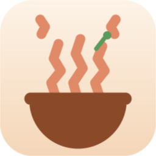
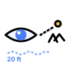
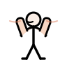

<div align="center">



# PUMZI

**A tiny menu-bar companion that reminds you to breathe, blink, sip, and stand.**

*In Swahili, **pumzi** means breath.*

[](https://github.com/sponsors/Abdulnasserh)
[](LICENSE)
[](#requirements)
[](https://www.rust-lang.org)

</div>

---

**PUMZI** is a free, open-source **break reminder** and **Pomodoro focus timer** for **macOS, Windows, and Linux**, built with **Rust** and **Tauri**. It covers the full 20-20-20 rule and beyond: eye rest, **hydration reminders**, **breathing exercises**, and **movement breaks** — with a dashboard, streaks, quiet hours, and zero telemetry. It lives in your menu bar and taps you when it's time.

## The problem: you are not just a pair of eyes

Most break reminders know exactly one trick: *look away from your screen every 20 minutes.*

That's a good trick. But by 3 p.m. it has failed you completely. You haven't stood since your first meeting. Your water bottle has been a desk ornament all day. Your breathing went shallow somewhere around hour two, and your shoulders have quietly relocated to somewhere near your ears.

Your body doesn't run on one need. It runs on **eyes, water, breath, and movement** — and they all need a refill, on their own schedule.

**PUMZI taps you on the shoulder for all four.** One small card in the corner:

- 👀 *"Look far away for 20 seconds."*
- 💧 *"Get up, walk to the water, and refill."*
- 🌬️ *"One slow box breath before you dive back in."*
- 🧍 *"Stand up, reach for the ceiling."*

And because a reminder you can predict is a reminder you'll ignore, PUMZI **shuffles the mix** — it never serves the same break twice in a row, and never lets one category hog the afternoon.

<div align="center">

| Eyes | Hydration | Breathing | Movement |
|:---:|:---:|:---:|:---:|
|  |  |  |  |

*Every break comes with its own hand-drawn animated figure.*

</div>

## What it does

- 🧠 **23 breaks across four categories** — eyes (4), hydration (3), breathing (4), movement (12), each with copy that doesn't sound like a corporate wellness email.
- 🃏 **Rotation without repeats** — shuffles categories first, then breaks within a category, so you get a balanced mix instead of the same break on loop.
- 🍅 **Pomodoro focus tasks** — give a task a time budget; PUMZI splits it into 25-minute sessions with 5-minute breaks (and a longer 15-minute break every four sessions). Alarm + notification when a break is due.
- 📊 **Dashboard** — focus countdown, task list, today's count, streak, seven-day chart, recent breaks. Watching the streak grow is embarrassingly motivating.
- 🤫 **Reminders that respect your time** — quiet hours (including across midnight), snooze, away detection, idle hold. Deep in flow? PUMZI waits.
- 🫥 **A break card that behaves** — appears in a corner, never steals focus, closes itself if ignored. It never piles up.
- 🔒 **Local only** — config and stats live in JSON files on your machine. No account, no network, no telemetry. Your 3 p.m. slump is nobody's business.

## Run it

Requires [Rust](https://www.rust-lang.org) 1.77+ and your platform's webview bits:

- **macOS**: Xcode Command Line Tools (`xcode-select --install`)
- **Windows**: WebView2 (installed by default on Windows 10/11)
- **Linux**: `webkit2gtk-4.1`, `libappindicator3`, and the usual Tauri build dependencies

```sh
cd desktop/src-tauri
cargo run
```

The first launch opens the dashboard. After that, PUMZI lives in your menu bar like a good butler: seen once, felt always.

Want the grand tour in one second?

```sh
cargo run -- --demo   # opens the dashboard and a break card immediately
```

Run the tests:

```sh
cargo test
```

## Package it

No npm, no Node, no Electron — the backend is Rust and the UI is plain HTML/CSS/JS rendered by the system webview. Install the Tauri CLI once:

```sh
cargo install tauri-cli --locked
```

Then build the app bundle from `desktop/`:

```sh
cargo tauri build
```

Bundles land in `desktop/src-tauri/target/release/bundle/`.

## Using it

- Add a task in the dashboard, then press **Start**. The countdown and tray timer only appear after you start a task.
- A task is a focus-time budget (for example 50 minutes). PUMZI breaks it into Pomodoro sessions and schedules breaks between them. **End task** stops the timer.
- Click the tray icon for controls: take a break, pause/resume, dashboard, quit.
- In a break card: **Start** begins the timer, **Done** records the break, **Snooze** delays it, and **Skip** moves on.
- The card closes itself after a while if you ignore it, so it never piles up.
- The dashboard has reminders, snooze length, card position, quiet hours, break mix, sound, login item, and reset controls.

Settings live in the platform app-data directory:

| Platform | Path |
|---|---|
| macOS | `~/Library/Application Support/com.pumzi.app/config.json` |
| Windows | `%APPDATA%\com.pumzi.app\config.json` |
| Linux | `~/.config/com.pumzi.app/config.json` |

Stats are stored next to the config in `stats.json`. Tasks and the active Pomodoro live in `tasks.json`.

## Uninstalling

PUMZI is fully self-contained — nothing spreads into your system, so leaving is as easy as arriving:

1. Quit it from the tray/menu-bar icon → **Quit**.
2. Delete `Pumzi.app` (drag it from /Applications to Trash). If you ran it with `cargo run`, nothing was installed system-wide — closing the process is enough.
3. Optional: remove settings and stats:

   ```sh
   rm -rf "~/Library/Application Support/com.pumzi.app"   # macOS
   ```

   (Windows: `%APPDATA%\com.pumzi.app`, Linux: `~/.config/com.pumzi.app`)
4. If you enabled **launch at login**, toggle it off in the dashboard first (or remove the entry in System Settings → Login Items).

No daemons, no leftovers.

## Project layout

```
desktop/
├── assets/figures/        animated SVGs for every break
├── data/breaks.json       23 break definitions and category copy
├── renderer/              break card + dashboard (plain web UI)
├── scripts/make-icons.py  regenerates app and tray icons
└── src-tauri/             Rust backend, tray, windows, scheduler
    ├── src/config.rs      defaults, validation, partial updates
    ├── src/scheduler.rs   intervals, quiet hours, idle/away behavior
    ├── src/tasks.rs       Pomodoro sessions, breaks, pause/resume
    ├── src/rotation.rs    category and break shuffle bags
    ├── src/stats.rs       daily totals, streak, seven-day summary
    ├── src/store.rs       atomic JSON persistence
    └── src/main.rs        windows, tray, commands, ticker
```

## Notes

- Developed and smoke-tested on macOS 12.7.6. The Tauri code is cross-platform, but Windows and Linux have not been tested yet.
- Idle detection currently uses CoreGraphics on macOS. On Windows and Linux the app still runs; "reset when away" simply has no idle signal yet.
- The break card uses a transparent, always-on-top, non-activating window on macOS.
- Icons can be regenerated with `python3 scripts/make-icons.py` (uses `sips` and `iconutil` on macOS).

<div align="center">

---

**PUMZI is free, and it would love to stay that way.**
If it saved your eyes, your back, or your afternoon — consider [sponsoring the project ☕](https://github.com/sponsors/Abdulnasserh).

<sub>Break content adapted from the original Noodle project. MIT licensed.</sub>

</div>
